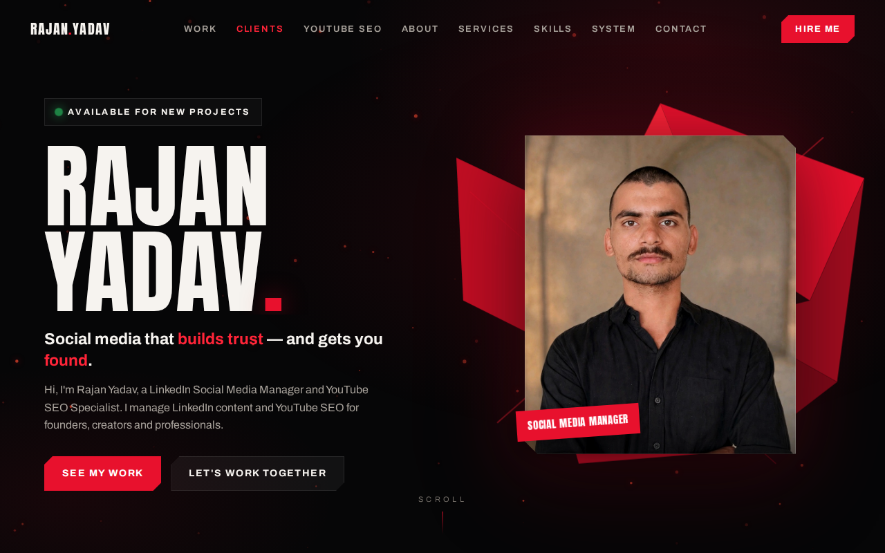
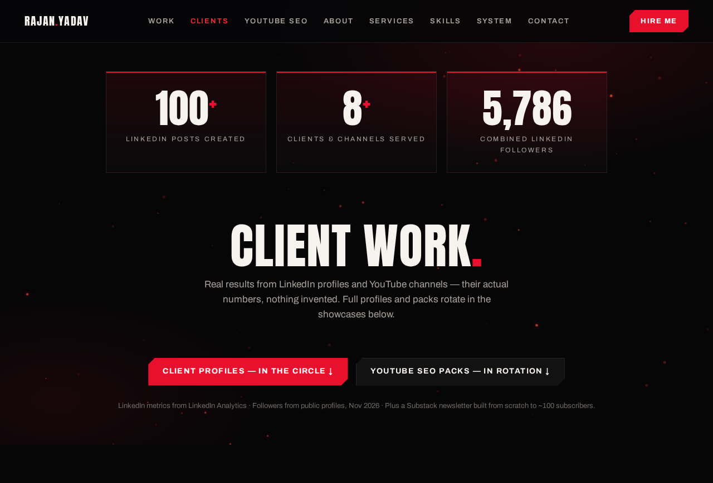
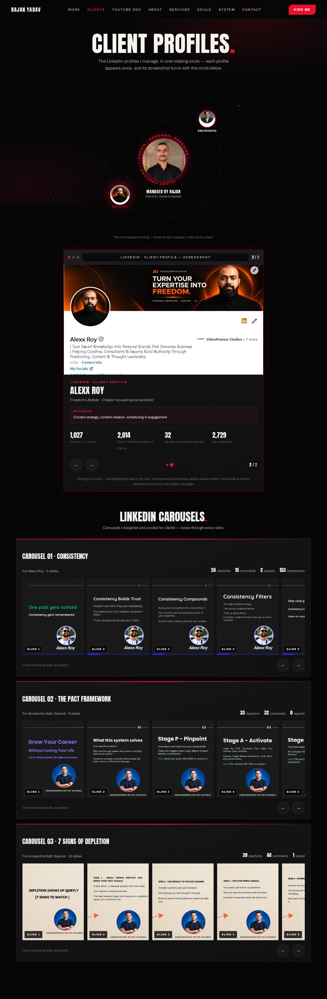
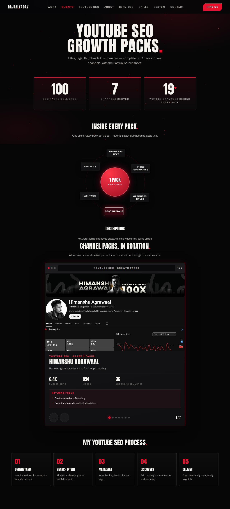
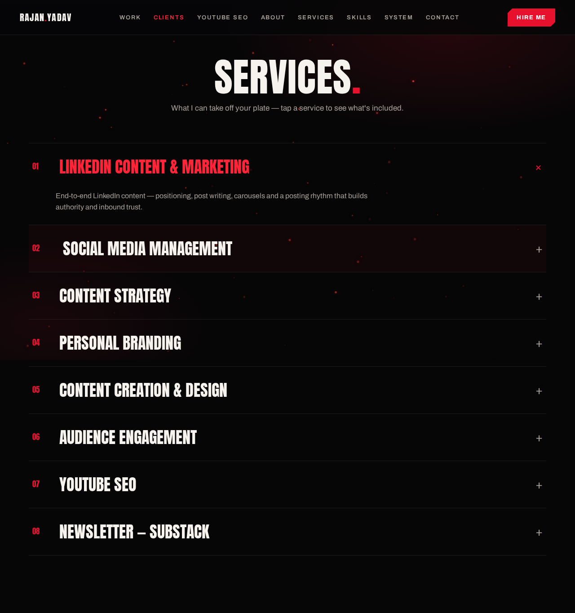

# Animated Portfolio

Rajan Yadav's new animated portfolio website — dark red and black design, inspired by the reference video. Single static page, animated and responsive.

## What's inside

- Hero with portrait, stats and floating ember particles
- Client Work with real results (Amarendra, Alexx, YouTube SEO channels)
- About, Services, Core Skills, My Toolkit, My System
- Contact form that opens WhatsApp

## Hosting

Vercel only. Import this repo on Vercel and deploy — no server or database needed.

## Preview

## Sections

### Client work

*Client work with real results — 100+ posts, 8+ clients and 5,786 followers.*

### Client profiles

*Client profiles with the orbit, Alexx's profile and carousel designs.*

### YouTube SEO growth packs

*YouTube SEO growth packs — 100 packs across 7 channels.*

### Services

*Eight services from the live homepage.*
